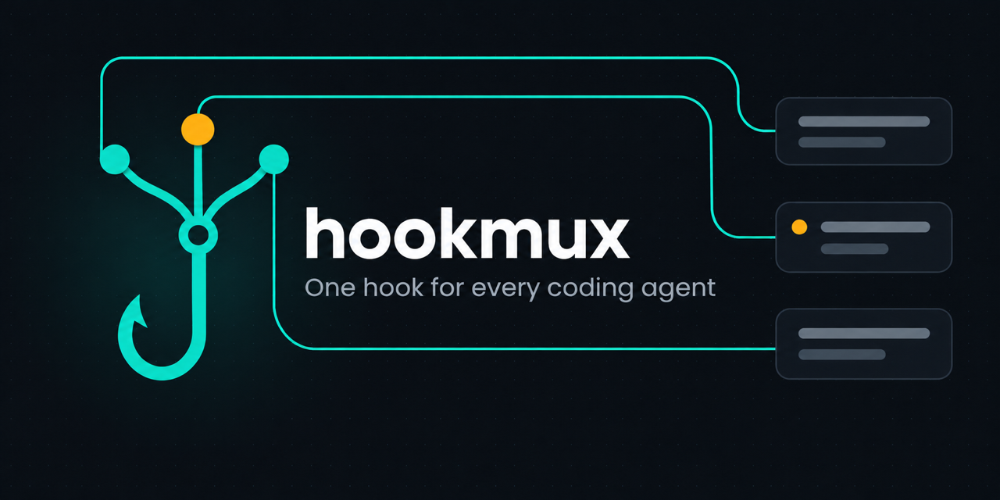

<p align="center"></p>

#  hookmux

hookmux gives Claude Code, Codex and Gemini CLI one hook entry per event and fans each event out to small TOML plugins that add context for the agent or block a prompt or tool call. It is for people who use one or more of these agents and want automatic reminders, skill suggestions and guards without writing a separate script for each client.

Claude Code (2.1.325) and Codex (0.167.1) have been tested live: adding context and blocking a prompt both work. The Gemini CLI adapter was written from the Gemini CLI source (v0.68.0) and is covered by tests, but has not been run against a live client yet.

## Install

hookmux needs Node.js 22 or later.

```sh
npx hookmux init
```

Or install the CLI globally first:

```sh
npm i -g hookmux
hookmux init
```

`init` installs the engine under `~/.hookmux`, writes the launcher that the agent clients run, and adds one hub entry per event to the config of each client you choose. Hooks run the launcher directly, never `npx`, so a hook never waits on the network.

## Quick start

The moodboard example ships in this repository. From a checkout of it:

1. Add the example plugin:

   ```sh
   hookmux add ./examples/moodboard
   ```

2. Approve it. Run this in your own terminal, because promote asks for confirmation and refuses to run without one:

   ```sh
   hookmux promote moodboard
   ```

3. See what the plugin decides for a prompt:

   ```sh
   hookmux explain "redesign the pricing page"
   ```

   `explain` prints each check's result and the output the agent would receive.

From now on, a prompt that asks for open-ended design work gets a short suggestion to load the `moodboard` skill.

## How plugins work

A plugin is a folder with a `plugin.toml`. It names the events it listens to, a few checks, an expression over those checks, and what to do when the expression is true:

```toml
schema = 1
id = "no-credentials"
events = ["prompt.submit"]
phase = "guard"
when = "secret_shape"

[checks.secret_shape]
kind = "regex"
patterns = ['AKIA[0-9A-Z]{16}', 'ghp_[A-Za-z0-9]{36}']

[[then]]
effect = "block"
reason = "The prompt looks like it contains a credential. Remove it and send again."
```

Checks run cheapest first. Pattern and context checks run in-process, and a slower check runs only when its answer could still change the result. When several plugins fire, their output is combined in phase and priority order, and a block wins. The [plugin reference](docs/plugins.md) covers every key, check kind, effect and override.

To have your agent write a plugin for you, ask it for one ("make a hook that reminds me to run the tests before a release"). hookmux ships an authoring skill, `skills/hookmux`, that walks the agent through writing, testing and installing the plugin in shadow mode, and a bundled plugin, `hookmux-authoring`, that points the agent at the skill when you ask for an automatic behaviour.

## Supported hosts

Effects each client supports per event:

<!-- hosts:begin -->
<!-- Generated by scripts/gen-skill-refs.ts from src/hosts. Do not edit; run `pnpm gen:refs`. -->
| Host        | `prompt.submit`       | `session.start` | `tool.before`         | `tool.after`          |
| ----------- | --------------------- | --------------- | --------------------- | --------------------- |
| Claude Code | inject, block, notify | inject, notify  | inject, block, notify | inject, block, notify |
| Codex       | inject, block, notify | inject, notify  | inject, block, notify | inject, block, notify |
| Gemini CLI  | inject, block, notify | inject, notify  | block, notify         | inject, block, notify |
<!-- hosts:end -->

Notes on each client, including the Codex and Gemini CLI adapters, are in [docs/hosts.md](docs/hosts.md). Codex runs a new or changed hook entry only once it is approved. `init` and `sync` approve hookmux's own hub entries through `codex app-server` and leave every other hook as it was; if that fails, approve them in Codex's `/hooks` screen.

## Commands

| Command                                       | What it does                                                                 |
| --------------------------------------------- | ---------------------------------------------------------------------------- |
| `hookmux init`                                | Installs the engine and launcher and registers hub entries with your clients |
| `hookmux uninstall`                           | Removes the hub entries from your clients' configs                           |
| `hookmux sync`                                | Updates the hub entries to match the events your plugins use                 |
| `hookmux add <dir>`                           | Installs a plugin folder; `--shadow` installs it in shadow mode              |
| `hookmux remove <id>`                         | Uninstalls a plugin                                                          |
| `hookmux enable <id>`, `hookmux disable <id>` | Turns a plugin on or off                                                     |
| `hookmux promote <id>`                        | Approves a plugin and makes it live; needs an interactive terminal           |
| `hookmux promote <id> --standing`             | Also lets later `hookmux add` runs of that plugin go live without asking     |
| `hookmux list`                                | Lists installed plugins and their status; `--json` for scripts               |
| `hookmux new <id>`                            | Scaffolds `plugin.toml` and `tests.toml`                                     |
| `hookmux validate <dir>`                      | Checks a plugin folder without installing it                                 |
| `hookmux test <id>`                           | Runs a plugin's `tests.toml` cases                                           |
| `hookmux explain "<prompt>"`                  | Shows how every installed plugin decides on a prompt                         |
| `hookmux doctor`                              | Reports problems with the install, client configs and plugins                |
| `hookmux log on`, `hookmux log off`           | Turns the decision log on or off                                             |
| `hookmux schema --json`                       | Prints the manifest schema, check kinds, effects and hosts                   |

The command set is still growing. `hookmux help` lists the commands in your installed version.

## Safety model

- Fail-open. If Node or the engine is missing, or the engine fails, hangs or runs past its deadline, the launcher prints nothing and exits 0, which every client treats as "no opinion". A check that errors or times out counts as unknown and never blocks. Because a guard that stops running stops blocking without a sound, every session start shows you a notice that names a guard plugin waiting for promote, or a plugin that does not load.
- Trust pins. `hookmux promote` records a SHA-256 hash of the plugin folder and the capabilities it has with your `config.toml` overrides. If a file changes afterwards, whether by you, an agent or an update, or an override adds a capability, the plugin stops running until you promote it again. A plugin you change often can get a standing approval (`hookmux promote <id> --standing`): a later `hookmux add` of it goes live without asking while it needs no capability beyond the ones you approved. Anyone who can run `hookmux add`, agents included, can then replace its files within those capabilities, and matchers, folder globs and the phase are outside them. `hookmux promote <id> --end-standing` ends it.
- Promote needs you. It asks you to type `y`, never takes `--yes`, and refuses when stdin is not a terminal or when it sees the environment Claude Code, Codex or Gemini CLI give the commands they run. This guards against an agent activating a plugin because of an injected instruction or by accident. It is not a sandbox: a process running as your user can still edit `~/.hookmux` directly.
- Previews run no unreviewed code. `hookmux test` and `hookmux explain --all` skip the scripts of plugins you have not promoted unless you pass `--run-scripts`.
- Shadow mode. A plugin added with `--shadow` (or `shadow = true`) is evaluated and logged, and adds nothing to the agent's context.
- Rules decide blocks. By default a block needs a check that is not model-backed to agree, so a misread by a model cannot discard your prompt.
- No telemetry. hookmux collects no usage data.
- Private logs. The decision log is off until you run `hookmux log on`. It keeps a short hash and the length of each prompt, and stores prompt text only when you also pass `--prompts`. It rotates at 1 MiB and keeps one previous file.

## Troubleshooting

- Run `hookmux doctor` first. It reports problems with the install, the client configs and your plugins.
- To see why a plugin did or did not fire, run `hookmux explain "<the prompt>"`.
- To trace real hook runs, turn the log on, reproduce the problem, then read `~/.hookmux/logs/hookmux.log`:

  ```sh
  hookmux log on
  # ...use your agent...
  hookmux log off
  ```

- To switch hookmux off for one session without uninstalling it, start the client with `HOOKMUX_DISABLE=1` in its environment. Guard plugins keep running, because a session can set that variable itself; turn one off with `hookmux disable <id>`, which the next session start reports.

## Uninstall

```sh
hookmux uninstall
npm uninstall -g hookmux
```

`uninstall` removes only the hub entries and leaves your other hooks alone. Your plugins, config and logs stay in `~/.hookmux`; delete that folder to remove them too.

## Documentation

- [Plugin reference](docs/plugins.md)
- [Host notes](docs/hosts.md)
- [Design notes](docs/design.md)
- [Contributing](CONTRIBUTING.md)
- [Security policy](SECURITY.md)

## License

MIT
